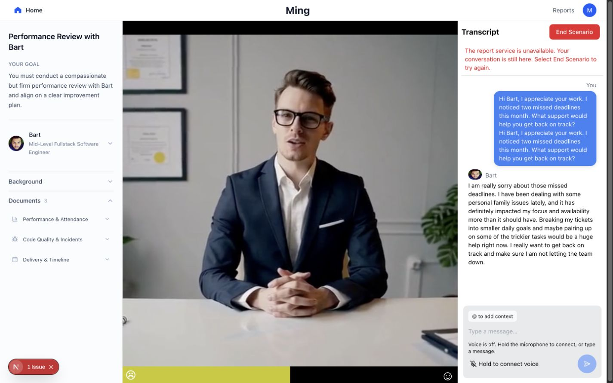
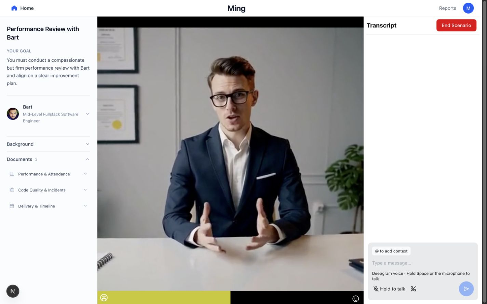
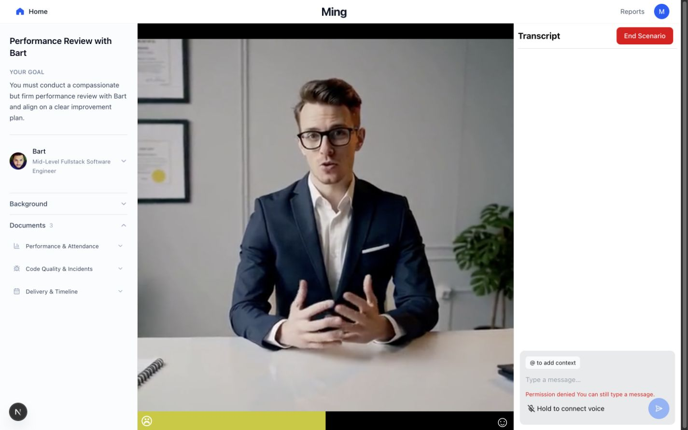

# Provider implementation verification — 2026-10-25

## Latest localhost configuration and recovery

The current Git-ignored `.env` selects `MING_VOICE_PROVIDER=deepgram` and
`GEMINI_MODEL=gemini-3.5-flash-lite`. Gemini 3.8 and 3.5 Flash returned intermittent
503 high-demand errors. Flash Lite passed the streaming API check and then Ming's
normal backend audio pipeline: real Deepgram STT, Gemini reply, transcript
persistence, and Deepgram TTS returned HTTP 200 with `status: success` and
106,128 bytes of MP3 audio. The test used a synthesized utterance, not a microphone
recording; see [recorded result](provider-evidence/gemini-lite-recovery.json).

Provider defaults in source remain Gemini text and OpenAI Live voice; the local
override is deliberately explicit. Keys and `.env` are not committed. Reproduce
this local selection by setting the two variables above and restarting `npm run dev`.

Latest cleanup checks: 152 regression tests, zero lint warnings/errors, both
typechecks and production builds, and the Deepgram built-stack smoke pass.
Adaptive follow-up and New Session browser checks passed with explicit fixtures.
The complete real microphone → report → adaptive follow-up rehearsal remains
unverified; the earlier real adaptive request timed out before the model override.
Historical results below describe their respective earlier checkpoints.

## Live credential check — later on 2026-10-25

The root `.env` now supplies `GOOGLE_API_KEY` and `DEEPGRAM_API_KEY` and is
Git-ignored. No OpenAI key is configured. Added `GOOGLE_API_KEY` as the final
server-side fallback for Gemini and the retained Veo helpers; no key values are
recorded here. Both providers accepted their keys.

Gemini 3.8 returned retryable HTTP 503 high-demand errors during the real browser
chat check, and the first voice reply timed out. An explicit rehearsal override
to `gemini-3.5-flash` responded successfully. Application defaults are unchanged;
there is no automatic cross-model fallback. The rehearsal command is:

```sh
MING_VOICE_PROVIDER=deepgram GEMINI_MODEL=gemini-3.5-flash npm run dev
```

Gemini voice replies now have a 1,024-token cap because thinking consumes the same
budget. Gemini 3/3.x uses low thinking for these short spoken replies; OpenAI keeps
its existing 250-token cap. Other/custom Gemini models receive no Gemini-3-specific
thinking settings. These branches have regression coverage.

Actual provider results, with no mocked provider responses:

- Deepgram generated a short neutral performance-review test utterance as WAV.
- Ming's normal Deepgram endpoint transcribed that audio, generated a Gemini 3.5
  reply, saved both actual texts, and returned 137,664 bytes of MP3 speech.
  HTTP 200, `status: success`, `persisted: true`, elapsed 8.97 seconds.
- An independent SQLite read confirmed both exact texts were stored in the
  conversation's messages.
- Ming's initial feedback request returned HTTP 200 in 28.24 seconds, but closer
  inspection found its summary cut off mid-JSON. Nonempty sections were not enough
  to establish report completeness. The separate browser run also rejected its
  report as incomplete. These findings prompted a report token-budget correction
  and explicit truncation guard before the follow-up rehearsal.
- The browser's typed Gemini 3.5 conversation also produced a real Bart reply.
- All 82 Node regression tests pass after the changes; both typechecks pass.

The report correction gives Gemini 4,096 tokens per stage, uses low thinking for
Gemini 3 models, and rejects explicit `finishReason: length` at every stage.
OpenAI's existing budgets are preserved. Regression tests cover provider branches
and ensure truncation stops downstream report generation.

The final real report retests were blocked by Google HTTP 429: the API reported
its daily free-tier request quota exceeded (limit 20). The browser recovered with
its conversation retained and a report-unavailable message. No further provider
calls were made after identifying the quota. The complete post-fix report and
voice → End Scenario → report rehearsal remain unverified until quota is available.



The audio fixture was synthesized, not captured from the user's microphone.
This verifies the real backend audio pipeline, not microphone capture, browser
speaker playback, or a successful OpenAI Live call. Veo generation was not invoked.

## Earlier implementation-only checks

The localhost demo defaults to Gemini for text reasoning and OpenAI Live for
voice. `MING_TEXT_PROVIDER=openai` selects OpenAI text; `MING_VOICE_PROVIDER=deepgram`
selects Deepgram speech recognition and speech synthesis around the selected text
model. These choices are independent and require a server restart. See
[`../../.env.example`](../../.env.example) for keys and model overrides.

Both Veo helpers are retained, including their scenario prompt, Veo model, polling
and video download behavior. Keys are loaded server-side and downloads are awaited.

## Verified locally

- 79 Node regression tests pass, including 16 Deepgram controller tests, backend
  provider HTTP/route tests, real Mastra/LibSQL transcript persistence with mocked
  AI generation, provider selection, Veo helper behavior, and report/security checks.
- The existing OpenAI voice suite passes all 19 tests (98 total regressions).
- Frontend and backend TypeScript checks pass. ESLint has zero errors and 61
  existing warnings.
- Frontend and backend production builds pass.
- Built standalone Next.js plus the actual Mastra backend pass the production
  smoke test in both OpenAI Live and Deepgram configurations. No provider keys
  are used. The selected Deepgram endpoint returns a recoverable 503 without its
  key; it returns 404 when the OpenAI voice configuration is selected.
- Codex browser: at 1440 by 900, Deepgram displays its hold-to-talk status and
  does not request microphone access until pressed. A microphone press reports
  permission denial while keeping typed input available. A typed request reaches
  the real keyless backend and recovers from 503 with its draft retained. End
  Scenario rejects this unsuccessful conversation instead of inventing a report.
- The running development app was restored to the defaults after the Deepgram
  browser check. It remains login-free.

## Not yet verified

The user deferred provider keys. No real Gemini, OpenAI, Deepgram, or Veo response
was generated in this verification. The Codex browser denied microphone access.
Live audio quality, latency, entitlement, and the complete real voice → End
Scenario → report rehearsal still require keys and a working microphone. Mocked
provider tests are not evidence of a successful live call.

## Browser evidence





## Reproduce

```sh
npm run typecheck
npm run typecheck --prefix src/backend
npm run lint
npm run test:voice
node --test tests/*test.mjs src/lib/tests/report-regression.test.mjs
npm run build --prefix src/backend
npm run build
node tests/production-security-smoke.mjs
node tests/production-security-smoke.mjs --deepgram
```

Build before starting the development server; they share `.next`. The smoke
scripts use isolated temporary databases and clear provider credentials.

No commit, push, or deployment was made.
