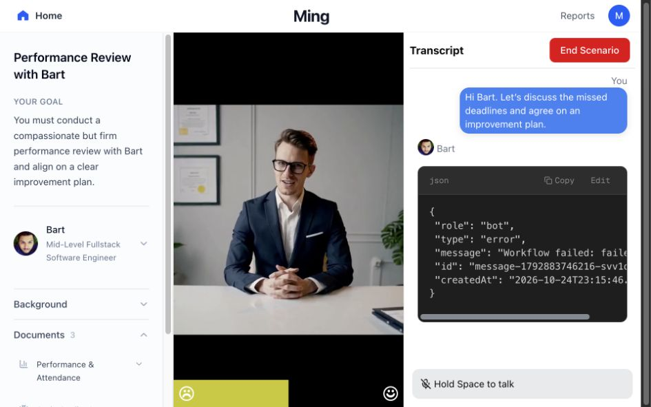
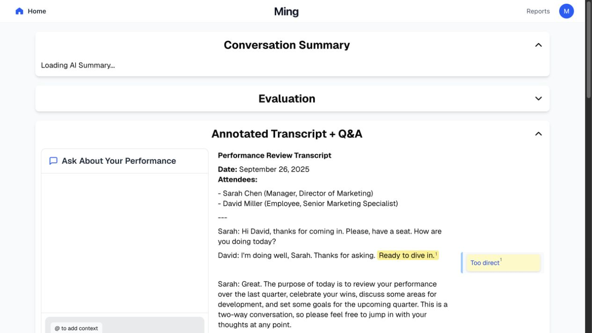

**Ming — GitHub Universe 2026 demo readiness audit**

Audited October 24, 2026, against `58183a76b62cc37ff8d1eac1ab021c810b60063b` on `main`. Application source and lockfiles were unchanged. This folder contains the audit, screenshots, reproducible defect probes, and validation logs.

**Decision: not ready to certify for a live stage demonstration or public production use.** The desktop experience renders coherently and both production builds work, but provider failures can kill the backend, report fallbacks misrepresent missing data, keyboard navigation is trapped, and public API access is unprotected in this configuration. These are fixable, concrete issues rather than a recommendation to redesign the product.

The agreed main demonstration is **choose scenario → voice conversation → end scenario → feedback report**. Adaptive follow-up is an optional extension after that path is reliable.

**What was actually checked**

- Three independent reviewers: GPT-6.1 Sol extra high for backend/security, GPT-6.1 Sol high for frontend flow, and GPT-6 Astra high for deployment and stage readiness. The primary agent independently ran builds, tests, browser checks, and the saved reproductions.
- Fresh locked dependency installs; frontend and backend production builds; standalone typechecks; lint; existing voice tests; separate npm advisory scans for both lockfiles.
- Real Next production build using Codex's in-app browser at `http://127.0.0.1:3000`, backed initially by the built Mastra server on port 4111. Desktop/default 1280×720, landscape 960×600, and portrait 390×844 were inspected. Temporary viewport overrides were reset.
- First-visit dashboard/report, scenario/document layout, Tab/Shift+Tab, typed chat with missing provider configuration, End Scenario after failure, and the resulting completion analytics.
- Real installed Mastra routing/workflows with synthetic memory and agent outputs, plus provider-failure tests with synthetic models. These are explicitly not live AI quality or latency tests.
- Current official provider documentation was checked: GPT-Live and GPT-5.4 Mini are legitimate current integrations. No paid model calls were made.

No stage URL was supplied. No root `.env` or `OPENAI_API_KEY` was present. Microphone permission remained unresolved in the automated browser and the connection was stopped; no microphone recording was performed. Successful live WebRTC, actual model entitlement, naturalness of replies, report accuracy, deployment behavior, venue networking, and end-to-end latency remain **unverified**.

**Validation results**

| Check | Result | Evidence / qualification |
|---|---|---|
| Locked installs, root and backend | Passed | Node 26.5.0, npm 12.0.1; install-script warnings occurred, but both builds subsequently succeeded |
| Frontend production build | Passed | [frontend-build.log](evidence/frontend-build.log); types and lint explicitly skipped by configuration |
| Backend production build | Passed | [backend-build.log](evidence/backend-build.log); produces `.mastra/output` |
| Frontend standalone typecheck | Failed: 8 diagnostics | [frontend-typecheck.log](evidence/frontend-typecheck.log); includes legacy chat code and incompatible Tiptap Editor types |
| Backend standalone typecheck | Passed | [backend-typecheck.log](evidence/backend-typecheck.log), empty output and exit 0 |
| Lint | Failed: 22 errors, 91 warnings | [lint.log](evidence/lint.log); not all diagnostics are active runtime defects |
| Existing voice tests | 19/19 passed | [voice-tests.log](evidence/voice-tests.log); mocked lifecycle/protocol checks |
| Frontend defect probes | Confirmed | [script](evidence/frontend-repro.mjs), [output](evidence/frontend-repro.txt) |
| Backend defect probes | Confirmed | [script](evidence/backend-repro.mjs), [output](evidence/backend-repro.txt) |
| Built backend missing-key request | Process exited 1 | [script](evidence/runtime-no-key-repro.mjs), [output](evidence/runtime-no-key-repro.txt), [server log](evidence/runtime-no-key-server.log) |
| Synthetic provider-error matrix | Tracing-on crashes; tracing-off silently succeeds empty | [script](evidence/stream-failure-repro.mjs), [output](evidence/stream-failure-repro.txt) |
| Root dependency audit | 6 critical / 44 high / 97 moderate / 6 low | [summary](evidence/dependency-audit-summary.json) |
| Backend dependency audit | 4 critical / 46 high / 69 moderate / 11 low | Separate lockfile; overlapping packages must not be counted twice |

Audit dependency counts include tooling, transitive dependencies, and inherited advisory severity. They are not counts of demonstrated exploitable application defects. The direct Next.js issue below is independently checked against the maintainer's advisory.

Initial build failures were environment restrictions: Google Fonts DNS/network access and Mastra's devcert configuration directory. Both builds succeeded after the required tooling access was provided; those initial failures are not counted as product defects. The font fetch does make a clean build network-dependent, so prebuild the stage artifact.

**Fix priorities**

P0 = block public exposure; P1 = fix before relying on the affected demo/release flow; P2 = correctness/hardening or later demo polish. Every row states the scope of its evidence.

| ID | Priority | Finding | Required outcome |
|---|---|---|---|
| R1 | P0 public | Next.js 15.4.4 has a critical published RSC vulnerability | Upgrade to a currently patched compatible release; rerun both builds, audit, and browser regression |
| R2 | P0 public | Built-in memory APIs permit anonymous conversation reads | Authenticate all relevant routes and enforce ownership; deny anonymous paid generation |
| R3 | P1 demo | Provider errors can terminate the backend; UI prints raw error JSON | Survive provider failure, return a typed recoverable error, and retain the user's transcript |
| R4 | P1 demo | Missing reports/ratings silently substitute unrelated content or invented scores | Truthful empty/error states and null scores throughout; examples only in an explicitly labeled mode |
| R5 | P1 demo | Tab/Shift+Tab are trapped; typed fallback disappears below 1024 px | Native focus traversal and a working text fallback at every supported size |
| R6 | P1 if shown | Adaptive next-scenario flow is disconnected and loses generated documents | Explicit generation from the report flow, validated shared schema, retry/recovery |
| R7 | P1 release | Backend deployment scripts target the wrong adapter; session state is process-local | One verified deployment topology with durable state and explicit API URL |
| R8 | P1 release | Build success bypasses failing quality gates | Passing typecheck/lint/build/test checks enforced in CI |
| R9 | P2 demo | Page visits count as completions; locked/unlocked UI claims are hardcoded | Count completed sessions exactly once and make progression truthful |
| R10 | P2 demo | Voice and delegated/text character instructions conflict | One active-scenario definition for voice, text, and evaluation |
| R11 | P2 security | Model-generated summary HTML is inserted without sanitization | Render restricted Markdown or sanitize before insertion |
| R12 | P2 reliability | Voice capacity leaks until TTL, races, and overflows startup history | Explicit session release, atomic capacity handling, provider-sized history |

**R1 — Patch the directly exposed framework before public release**

`package.json` pins Next.js 15.4.4 and this app uses App Router. The maintainer's [RCE advisory](https://github.com/vercel/next.js/security/advisories/GHSA-9qr9-h5gf-34mp) identifies affected Next 15 App Router versions; 15.4.8 was the fix for that particular advisory. Subsequent advisories also exist, so do not treat that historical minimum as a sufficient current upgrade target. The live npm audit suggested 15.5.28 at audit time; verify compatibility with React, Cedar, and OpenNext before selecting the upgrade.

No exploit was run. Deployed version and any external protections are unknown. Other audit findings require dependency-path and feature-reachability triage rather than a blanket `audit fix --force`.

**R2 — Protect both custom and built-in backend APIs**

`src/backend/src/mastra/index.ts:52` configures only `apiRoutes`, without authentication. The saved reproduction uses the real installed router, with synthetic memory instead of a private database. All three requests returned HTTP 200 without a token:

```text
GET /api/memory/threads?agentId=defaultAgent&resourceid=synthetic-owner
GET /api/memory/threads/synthetic-thread?agentId=defaultAgent
GET /api/memory/threads/synthetic-thread/messages?agentId=defaultAgent
```

The message route returned synthetic private transcript content and queried by thread ID without a resource ownership check. In `src/backend/src/mastra/apiRegistry.ts:119`, voice session creation ignores the supplied token, and other generation routes have no user authentication configured. Voice capability tokens on sync/delegation do not protect these entry points or built-in memory routes.

For a controlled conference demo, restrict the whole service to the presenters through an authenticated boundary. Before supporting public users, derive identity server-side, enforce per-session ownership, restrict unneeded framework routes, and add per-user quotas. Verify the same requests fail without appropriate authorization. External gateway protections, if any, were not inspected.

**R3 — Make provider failure survivable and readable**

The actual production backend on Node 26.5.0 accepted a synthetic typed request without an API key, returned an SSE error, then exited with code 1. The Codex browser showed that error as JSON attributed to Bart. The next End Scenario attempt displayed `Failed to fetch` because the backend was gone.

The independent synthetic-provider matrix reproduced the crash with tracing enabled, both with and without memory. With tracing off, the process survived but incorrectly completed with empty success. This is not evidence that every provider failure on every Node version crashes; it confirms two failure modes for the exact tested versions/configuration.

Relevant code: `src/backend/src/mastra/index.ts:47` enables tracing; `src/backend/src/mastra/workflows/chatWorkflow.ts:147` does not handle `error` chunks explicitly; `src/cedar/components/chatMessages/ChatRenderer.tsx:112` falls back to serializing a message without content. Installed Mastra tracing eagerly traverses stream getters, creating detached rejected promises on stream failure; the route's catch cannot contain those rejections.

Fix configuration preflight, explicit stream-error propagation, the tracing/runtime incompatibility, and a friendly error renderer with retry. Disabling tracing alone is insufficient because it leaves the observed false-success path. Acceptance: a synthetic unavailable-provider request leaves the server alive; a subsequent healthy request succeeds; the transcript is retained; report generation is never represented as completed on failure.



**R4 — Remove misleading report fallbacks**

On a fresh first visit to Reports, `src/app/report/page.tsx:52` leaves “Loading AI Summary...” indefinitely when there is no report. `src/components/AnnotatedTranscript.tsx:209` then loads `/sample.md`, an unrelated Sarah Chen/David Miller marketing review dated September 26, 2025. This was visibly reproduced without a successful conversation. The same fallback is reachable when a generated report has no parsed transcript segments.

Separately, `src/app/report/parser.tsx:23` starts with scores `[85,90,80,75,88,99]` and keeps missing categories at those values. The exact parser with a missing-rating fixture returns those scores while the newer evaluation model correctly returns six nulls. `src/app/report/page.tsx:67` saves the fabricated numeric scores for dashboard/coaching use. The absence of a score must remain unknown in all views.

Acceptance: first-visit Reports says no report yet and offers Start Scenario; malformed/partial results show a recoverable error or explicitly partial result; no sample transcript or invented score appears as user performance. Preserve the null-aware EvaluationGrid behavior.



**R5 — Keep the main conversation operable**

`src/cedar/components/chatInput/ChatInput.tsx:90` intercepts every Tab and Shift+Tab globally. Browser presses in the editor left focus on the same contenteditable DIV for both keys. Native keyboard traversal cannot reach End Scenario, microphone, documents, or navigation. This is a keyboard accessibility failure, not a stylistic preference.

The same component uses `max-lg:hidden` for text input/send (`:183`, `:314`). At 960×600 the actual textbox was invisible, leaving voice as the only conversation input. At 390×844 the scenario intentionally shows only “Please Rotate Your Device”; rotation to a narrow landscape view still does not restore typed fallback. Desktop at 1280×720 renders the three-column scenario clearly.

Keep the editor available at all supported widths, use responsive panels instead of removing essential controls, and stop globally overriding Tab. For the stage laptop, rehearse at the actual projector resolution and browser zoom. Portrait mobile can remain an explicitly documented unsupported mode if that is a deliberate scope decision.

**R6 — Connect and validate adaptive follow-up before demonstrating it**

End Scenario stores a report and sets a flag before routing to `/report` (`SidePanelCedarChat.tsx:303`). Follow-up generation is started only on the scenario page (`src/app/scenario/page.tsx:68`). The report reads existing scenario data once (`src/app/report/page.tsx:72`). A clean first completion therefore has no newly generated next scenario until a different navigation path revisits the scenario page.

There is also a confirmed data-contract defect: the producer stores `reports` (`scenario/page.tsx:95`) while the loader passes `data.report` (`src/lib/scenarioUtil.ts:59`). The saved probe confirms the document argument is undefined, producing `<root>undefined</root>` instead of document XML. The parser omits analyzer goal/situation fields and hardcodes the NPC name Bill, further weakening follow-up context.

Make follow-up generation an explicit report action or completion phase, with pending/failed/retry states. Use a shared typed, versioned schema and validate before navigation. Acceptance: a fresh session reaches a follow-up with its correct persona, goals, documents, and evaluation context without revisiting the old scenario.

**R7 — Freeze a reproducible deployment topology**

The backend builds using `mastra build`, but its package scripts for deployment invoke the Next.js OpenNext adapter; backend Wrangler expects `.open-next/worker.js`. The actual successful backend build produces `.mastra/output`. No backend Next application or Mastra Cloudflare adapter is configured here. This is a source-confirmed deployment mismatch, not a claim that an existing remote deployment is down.

The voice registry lives in a process-local Map (`src/backend/src/lib/voice.ts:120`) and memory uses a local SQLite file (`src/backend/src/mastra/memory.ts:4`). A capability created in instance A received 401 when used in B in the reproduction. A worker restart or replica routing can break delegation/sync during an otherwise open voice connection.

A practical first demo topology is a built Next frontend plus one persistent HTTPS Node/Mastra instance with persistent disk, an explicit build-time `NEXT_PUBLIC_URL`, and access control. This is a proposal, not a verified deployment. If serverless/multiple instances are required, move session capabilities and database state to suitable shared persistence. Rehearse a restart and confirm truthful reconnect/save behavior.

**R8 — Enforce meaningful release gates**

`next.config.ts:7` suppresses both typechecking and linting in the build. The standalone checks currently fail even though the build succeeds. No tracked CI workflow exists. Fix or remove obsolete components implicated by the errors, align editor types, and enforce root/backend checks separately. Existing voice tests are valuable but do not cover the complete hook/UI/provider/production route chain.

Add deterministic integration coverage for report integrity, failure recovery, session isolation, and the agreed browser journey. Keep a separate live-provider smoke gate for model entitlement, audio, and real generated report quality. Record the chosen Node version rather than assuming any version above the README minimum behaves identically.

**R9 — Make progress and feature promises truthful**

`src/app/scenario/page.tsx:58` increments `numScenariosCompleted` on mount and every tab-visible check before testing completion. The offline reproduction produced 3 completions for mount plus two visibility events without a report. In the actual browser, a failed conversation/report attempt still produced “1 of 5 scenarios completed.” `src/components/AchievementsCard.tsx:10` hardcodes the first achievement as unlocked.

Count successful identified sessions once. The Home copy also promises unlocking while Workplace Conflict and Employee Layoff remain permanently locked literals (`src/app/page.tsx:84`, `:93`). Label them as planned scenarios unless progression is implemented.

**R10 — Align character behavior and presentation claims**

Voice startup says Bart is initially defensive/frustrated (`voice.ts:169`), while delegated and typed prompts make him humble, apologetic, and explicitly not defensive (`src/backend/src/lib/prompts.ts:45`). Typed conversation always prepends that original performance-review prompt (`chatWorkflow.ts:88`) even for adapted scenarios. The actual payload contradiction is confirmed; its effect on live generated speech remains untested.

Use one active-scenario character description for all modes. Explain the current product accurately: specialized role-play/analysis agents, text-derived sentiment, and a prerecorded avatar loop. The README still describes Gemini despite the active OpenAI model paths; the avatar is not live lip-sync; multi-party conversation and scenario import should not be presented as completed capabilities. Preserve the historical Gemini hackathon award as historical context.

For the stage, introduce the people and goal, use one supporting document, then show a report quote tied to something actually said. Avoid spending the limited demo on locked cards or analytics whose history is not real.

**R11 — Restrict generated HTML**

`src/app/report/page.tsx:100` inserts `marked.parse(summary)` through `dangerouslySetInnerHTML`. The real parser/Markdown pipeline preserved a harmless event-handler attribute in an offline fixture. Render restricted Markdown or sanitize the generated HTML. The test did not execute JavaScript, demonstrate model prompt-injection success, or establish cross-user exploitation; reports are currently browser-local.

**R12 — Fix voice limits before repeated/public sessions**

- There is no server close/release method. Sequential session 101 receives 429 until the 90-minute registry TTL expires, even when earlier calls have ended.
- Capacity is checked before awaiting the provider. A synthetic batch of 110 concurrent creates all succeeded despite the nominal 100-session cap.
- Up to 128 incoming short history messages can receive an extra developer message, producing 129 startup items. The [official Live session reference](https://developers.openai.com/api/reference/resources/live/methods/create) caps startup input at 128.

These were reproduced with synthetic dependencies, not a paid provider or load test. Fix atomic reservations, release/expiry, and history budgeting. They are lower priority than the short-demo blockers but matter for repeated rehearsals and public availability.

**Visual assessment and improvements**

The three-column desktop scenario is readable and the sidebar's native disclosures and focus styles are worth retaining. The null-aware evaluation cards are an improvement over the old score parser. A full visual redesign is not required for the agreed demo.

The scoped Impeccable rubric is a qualitative implementation assessment, not a WCAG certification or performance benchmark:

| Dimension | Score / 4 | Evidence |
|---|---|---|
| Accessibility | 1 | Global Tab trap; good native sidebar disclosures |
| Performance | 2 | Scenario first-load JS 791 kB, report 639 kB from build; latency/CWV not measured |
| Responsive design | 1 | Text fallback hidden at 960 px; portrait scenario blocked |
| Theming | 2 | Existing tokens mixed with hardcoded colors; dark-mode contrast not verified |
| Implementation integrity | 1 | Unlabeled sample transcript, invented fallback ratings, false completion counts |
| Total | 7 / 20 | Significant functional work before polish; incomplete measurements are disclosed |

The mechanical UI detector flagged a bouncing Home affordance and an annotation accent border. Those are low-priority style signals; neither was promoted to a demo blocker. Prioritize clear connection status, text fallback, visible retry actions, and report provenance. Add reduced-motion support and inspect print/export clipping after the functional fixes. A long generated report's actual print layout was not verified.

**Suggested work batches and acceptance gates**

1. **Protect and stabilize:** patch framework dependencies, authenticate the service, resolve streaming/tracing failures, add configuration/health checks, and render actionable errors. Gate: unauthorized reads fail and provider failure cannot kill the process or become empty success.
2. **Make the core demo truthful:** remove sample/default-score fallbacks, fix completion accounting, preserve the final transcript, restore native keyboard traversal and text input at supported widths. Gate: complete and fail the flow repeatedly without invented results or lost recovery controls.
3. **Align voice and report context:** unify Bart's persona, validate transcript/report output, add progress stages/time budgets and resumable report generation. Gate: actual spoken text appears faithfully in the report and feedback references the same session.
4. **Optional adaptive extension:** fix generation timing and the scenario package contract. Gate: fresh first completion reaches the correct follow-up, including documents.
5. **Freeze and rehearse:** enforce CI, select the deployment topology, verify the actual hosted build, then polish. UI-specific follow-ups map to Impeccable harden, adapt, and finally polish; none were applied during this audit.

**Stage rehearsal checklist**

- Record the commit, Node version, provider models, frontend/API URLs, and artifact build. Rehearse the production artifact, not only dev mode.
- Start with fresh browser storage: open the performance review, expand one document, exchange three short spoken turns, ask one factual question grounded in that document, end the scenario, inspect report quotes, and ask one feedback question.
- Measure connection, first-audio, finalization, and report-generation latency. Suggested starting budgets are 10 seconds to connect and 30 seconds to report; these are proposed budgets, not achieved measurements.
- Repeat twice and confirm a new scenario has no old conversation, each successful completion counts once, and refresh/retry behavior is explicit.
- Test microphone denial, audio playback blocking, tab switch while push-to-talk is held, provider timeout, backend restart, interrupted finalization, and report-generation failure. Require a visible recovery action in each case.
- Use the actual laptop, projector/window dimensions, microphone/speaker routing, venue Wi-Fi, and hotspot backup.
- Keep a clearly labeled prerecorded successful run and an explicitly labeled example report ready. Never silently substitute either for a live result.

**False positives explicitly removed**

- Both real Mastra workflows succeeded with synthetic agents despite their unused combine steps. The absent `combinedReport`/`combinedPackage` fields did not break the currently consumed result fields.
- GPT-Live session creation, WebRTC delegation, and append events match [official Live delegation documentation](https://developers.openai.com/api/docs/guides/live-delegation). GPT-5.4 Mini is documented in the [official model reference](https://developers.openai.com/api/docs/models/gpt-5.4-mini). Unfamiliar model names were not treated as bugs.
- Unused legacy components with hardcoded localhost paths were not treated as active-path failures. An unused Google-key helper was not reported as a shipped secret leak.
- Passing builds and mocked tests were not used as proof of successful live voice, actual production deployment, or generated report accuracy.

**How to rerun the saved evidence**

```bash
npm run test:voice
node docs/demo-readiness-2026/evidence/frontend-repro.mjs
node docs/demo-readiness-2026/evidence/backend-repro.mjs
node docs/demo-readiness-2026/evidence/stream-failure-repro.mjs
# After building the backend; starts an isolated local test port:
node docs/demo-readiness-2026/evidence/runtime-no-key-repro.mjs
```

The defect probes assert the observed bugs. Their PASS output means the defect reproduced; after fixing the application those assertions should be replaced by meaningful regression expectations. The runtime probe creates synthetic local test records and uses port 44119. It explicitly removes the provider key from its child environment. No production service is tested by these scripts.
