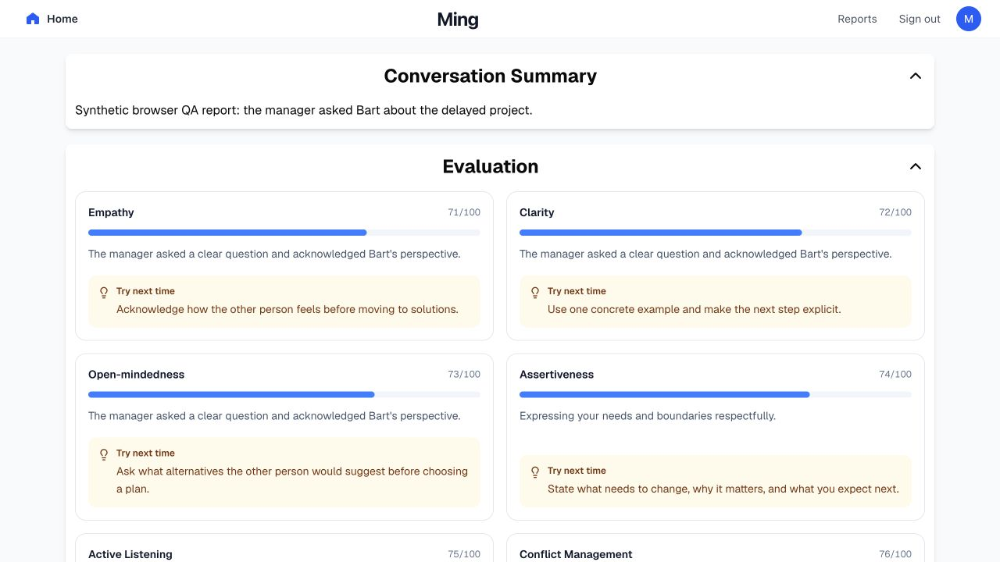
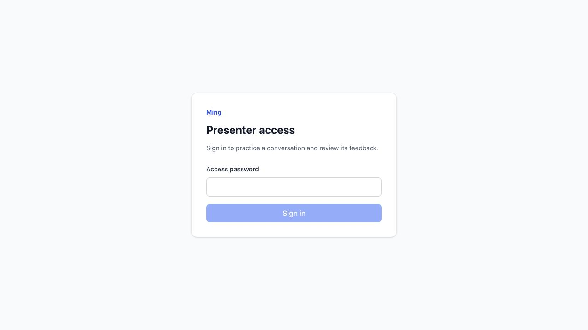

# Production security and type-error follow-up

> Historical verification before the localhost scope correction: presenter login, signed cookies, sign-out, and login-based isolation described below have since been removed at the user's request. The app now opens directly. Current setup: [localhost instructions](../PRODUCTION.md).

Verified locally on 2026-10-24 under official Node 24.22.1. All changes remain uncommitted; no push or deployment was performed. This adds to the earlier demo fixes rather than replacing their evidence.

## Localhost correction verification

The user clarified that this is a localhost demo. The presenter gate, auth endpoints, password/signing settings, signed cookies, sign-out UI and sign-out storage clearing have been removed. Home, scenario and report pages open directly. `npm run dev` generates the internal server-to-server token automatically; no manual access setup is needed.

The corrected build, frontend typecheck, eight focused frontend regression tests and standalone runtime smoke pass. Codex browser testing verified direct home access → scenario → synthetic chat reply → synthetic report without login. A localhost/127.0.0.1 origin normalization issue found during this test was fixed and covered by regression checks. Updated logs are `evidence/localhost-no-login-*.log`; screenshot: [direct home access](evidence/local-demo-no-login.png). Live provider and microphone behavior were not exercised by this correction.

## Implemented

- Presenter access gate with signed, expiring HttpOnly cookies, exact-origin checks, login throttling, and fail-closed missing configuration. Sign out and new login clear app-owned browser data.
- Same-origin Next gateway keeps backend credentials server-side. Only eight application POST endpoints are forwarded. Client-supplied identities are discarded; Mastra's built-in APIs are denied even to gateway-authenticated callers.
- Durable thread ownership checks, isolated derived analysis threads, identity-bound voice capabilities, bounded request size/structure, generation budgets, output limits, and atomic voice capacity reservations.
- Patched Next/React/sharp/PostCSS and compatible transitive dependencies; removed unused vulnerable tooling and invalid Cloudflare deploy configuration. Resolved the reproduced Motion export mismatch exposed by the production build.
- Fixed the eight original TypeScript errors and errors surfaced by the new boundary. Restored mandatory type/lint checks during builds and added CI, including a built-stack runtime smoke.
- Security headers, safe Markdown rendering, persistent database configuration, and a private-backend Node 24 container topology.

## Verification

| Check | Result |
| --- | --- |
| Frontend and backend TypeScript | Both pass, zero errors |
| ESLint | Zero errors; 61 existing warnings |
| Demo, streaming, completion, report regressions | 31/31 pass |
| Voice regressions | 19/19 pass |
| Frontend/backend security, Markdown, headers/build safeguards, storage isolation | 15/15 pass |
| Production builds | Frontend and backend pass |
| Isolated production backend | Pruned dependencies, Node 24, no instrumentation bootstrap: boots; authorization, hidden routes, missing-key recovery, byte and structure limits pass |
| Built-stack smoke | Isolated Next standalone artifact plus public/static assets, actual built Mastra: assets, signed login, anonymous denial, CSRF, framework API denial, input limits, two recoverable missing-key responses, authenticated page, and logout pass |
| Compose configuration | Validates; Docker daemon unavailable, container boot not claimed |

The 65 automated regression tests use no model provider calls. The backend tests include route/method denial matrices, cross-session ownership and races, forged identity, capability mismatch, quotas and capacity. Clean-state frontend typechecking was also verified in a temporary copy without `.next`.

Logs and audit counts are in [evidence](evidence/). The built-stack smoke now runs the same standalone frontend entry point as Docker and checks referenced static assets. Backend native-module resolution was separately verified in an isolated, pruned runtime directory.

## Codex browser retest

Tested the production frontend at loopback with temporary synthetic credentials and an explicitly synthetic backend fixture. No live AI quality or successful microphone capture is implied.

1. Wrong password is rejected; correct password opens the app.
2. HTTP and stream failures retain the message draft and expose retry guidance. End Scenario cannot generate a report without a successful assistant turn.
3. Retrying produces a synthetic Bart reply. A failed report retains the conversation; retry opens a report with the fixture's six scores.
4. Sign out returns to the access gate. Visiting `/report` directly remains gated.
5. Signing in again shows zero completed scenarios, unscored analytics, and “No report yet.”

## Remaining release conditions

Production npm audit has **0 critical / 4 high** frontend findings and **0 critical / 14 high** backend findings. These overlapping dependency paths stem from legacy Zod and disabled OpenTelemetry features. Input caps and disabled/unloaded telemetry mitigate reachable exposure; the affected packages are not all patched. A compatible SDK migration is required for a zero-high audit. See [deployment guidance](../PRODUCTION.md) for advisories, controls and operational limits.

Configure real secrets and the HTTPS origin, keep Mastra private, use persistent storage and one replica per service, and verify the Docker boot on the deployment host. Rehearse actual voice, model entitlement/quality, latency, restart/reconnect and the end-to-report flow on the presentation laptop. The presenter gate uses a shared password and eight-hour stateless sessions; sign out clears the browser cookie but cannot revoke a copied token before expiry. Password or signing-secret rotation revokes all sessions.
